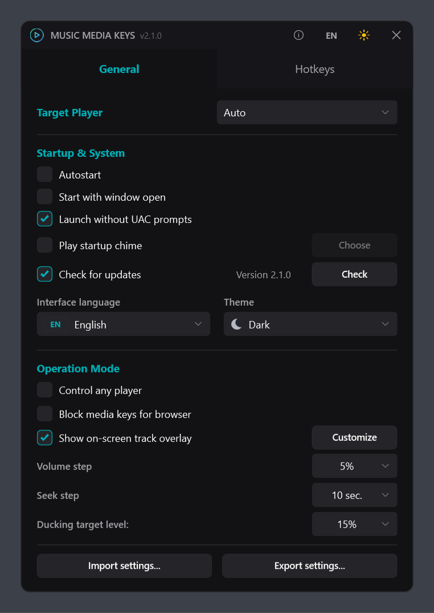
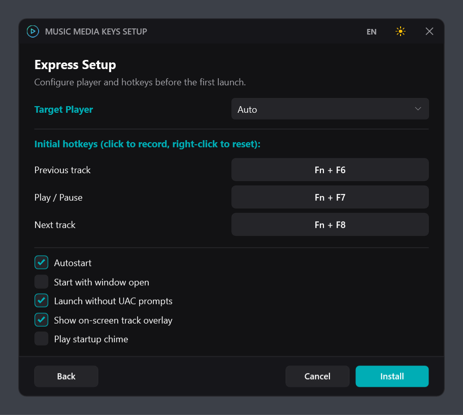
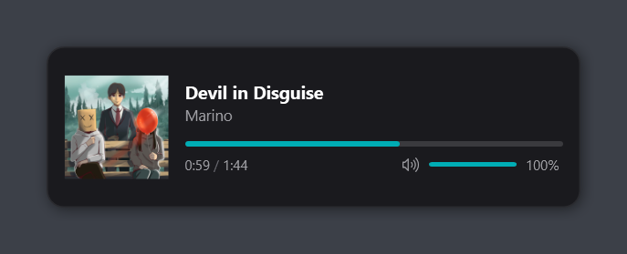
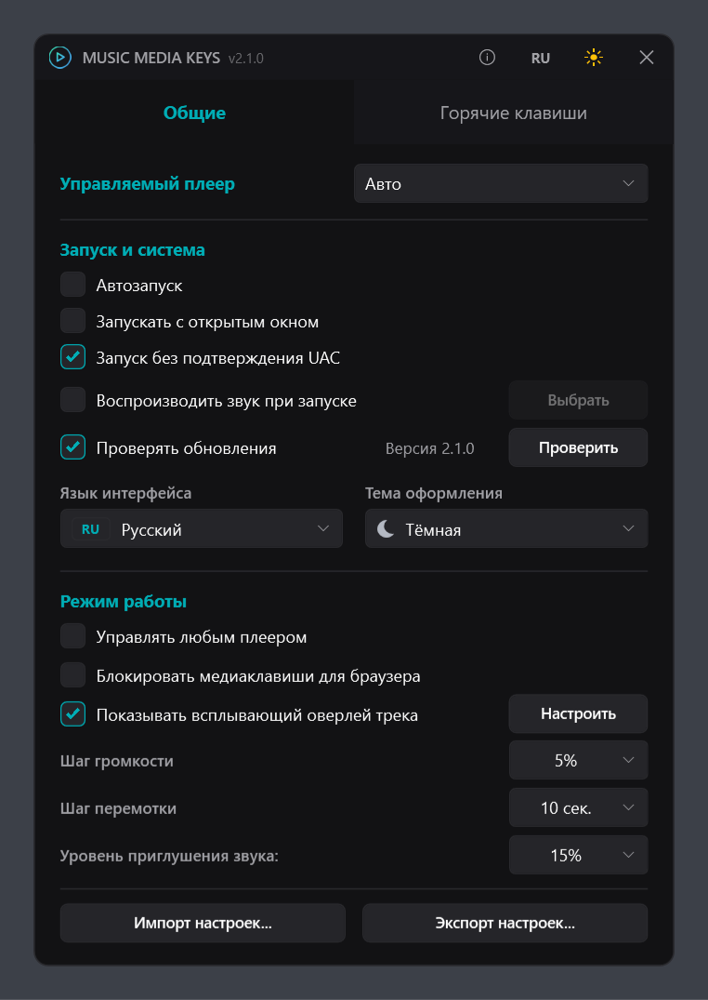
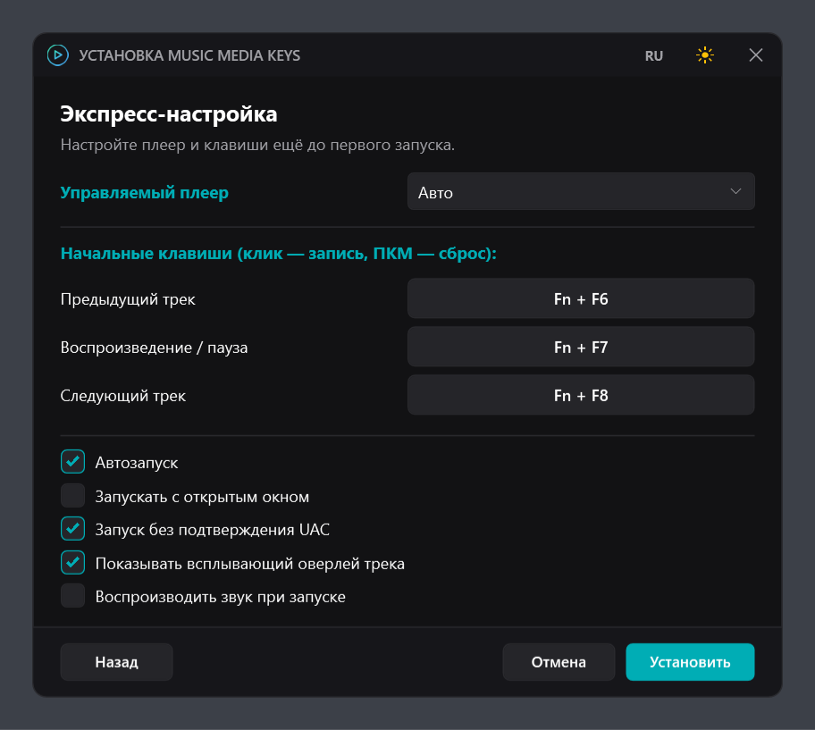

# Music Media Keys

[English](#english) | [Русский](#русский)

---

## English

A feature-rich yet easy-to-use Windows tray utility (`.NET 10` / WPF, standalone ~59 MB single-file EXE, no .NET runtime required) for controlling **Spotify**, **Yandex Music**, and any active media player via global hotkeys. Works right out of the box with a quick setup wizard and default media keys, while letting you customize everything—track overlay, target player, volume step & ducking, custom hotkeys, and 29 languages—whenever you need it.

**[Download latest release (v2.1.0)](https://github.com/exalesss/MusicMediaKeys/releases/latest)** — available as `MusicMediaKeys-Setup.exe` (installer) and portable `MusicMediaKeys.exe`.

### Screenshots

  
  

  

### Features

- **Global hotkeys (`RegisterHotKey`)**: control previous / play-pause / next track and volume without low-level keyboard hooks or anti-cheat input interference. Duplicate bindings are highlighted in the UI; right-click any hotkey field for presets or **Clear**.
- **Flexible player targeting**: direct targeting (`Spotify`, `Yandex Music`, custom player process, or `Auto`), **Control any player** mode (direct WinRT GSMTC + active-window fallback; adjusts system volume), and **stay-open tray cycling** across detected running players.
- **Per-app & system volume**: adjustable volume step (`1%`–`100%`) targeting either the managed player's audio session or the default audio device (when **Control any player** is enabled).
- **Browser media key protection**: optional blocking of media keys when a browser is focused so commands stay on your music player.
- **Track overlay**: compact on-screen popup with album art (blurred backdrop for non-square covers / YouTube Shorts), track title/artist, interactive timeline scrubbing, volume slider, mute toggle, customizable screen position (8 grid spots), scale (`75%`–`140%`), duration (`1`–`10s`), and hiding over full-screen apps.
- **Custom app actions**: assignable hotkeys for rewind / fast-forward (`1`–`300s` step), copy current track info, show/toggle overlay, cycle target player, toggle **Control any player**, and open settings tabs.
- **Installer, First-Run Wizard & UAC convenience**: dedicated installer (`MusicMediaKeys-Setup.exe`) with standard Windows uninstall, Welcome Wizard on first launch, optional startup sound (built-in or custom audio file), tooltip toggle `(i)`, and JSON settings export/import.
- **Autostart & GitHub updates**: optional Windows logon autostart, **Launch without UAC prompts** via Windows Task Scheduler, and built-in GitHub Releases updater with SHA-256 verification.
- **Themes & Languages**: Light and Dark themes; **29 UI languages** (with a searchable language catalog in the installer and an ISO language menu in the app).

### Security & SmartScreen

- **Why Administrator privileges?** Music Media Keys runs elevated so global hotkeys and media controls work reliably over elevated games and applications without Windows UIPI blocks. The full source code is open in this repository for security auditing.
- **Windows SmartScreen:** Because standalone binaries are not signed with a paid EV code-signing certificate, Windows Defender SmartScreen may show an unrecognized app warning on first launch. Click **More info** → **Run anyway**.

### Usage

1. Run `MusicMediaKeys-Setup.exe` to install (or run portable `MusicMediaKeys.exe` directly), and confirm the UAC prompt on first launch.
2. Complete the **Welcome Wizard** to choose language, theme, target player, and basic hotkeys.
3. Right-click the tray icon → **Open** or **Hotkeys** (or double-click the tray icon), and use the tray's player item to cycle detected players without closing the menu.
4. Click any hotkey box and press a key combination (`Esc` cancels, right-click opens presets or **Clear**).

**Uninstall:** Installed version — **Windows Settings → Apps → Installed apps → Music Media Keys → Uninstall** (removes files, shortcuts, and scheduled tasks). Portable version — disable Autostart / Skip UAC (if enabled), close the app, and delete `MusicMediaKeys.exe`.

### Default hotkeys

| Action                   | Default               |
| ------------------------ | --------------------- |
| Previous track           | FN+F6                 |
| Play / Pause             | FN+F7                 |
| Next track               | FN+F8                 |
| Volume Down / Mute / Up  | FN+F2 / FN+F3 / FN+F4 |

All hotkeys can be changed or cleared in settings.

### Building from source

- Build installer + standalone EXE: run `build-installer.bat` (outputs `bin\SingleExe\MusicMediaKeys.exe` and `bin\SingleExe\MusicMediaKeys-Setup.exe`).
- Build standalone EXE only: run `build-single-exe.bat` (outputs `bin\SingleExe\MusicMediaKeys.exe`).
- Run tests: `dotnet test MusicMediaKeys.Tests\MusicMediaKeys.Tests.csproj -c Release`.

### License

**Source-Available Non-Commercial License (No Derivatives)** — the source code is open for security auditing and personal local builds, and official binaries are free to use, while forks, derivative works, redistribution, and commercial use are prohibited. See [LICENSE](LICENSE) for full terms.

### ☕ Support the Author

Music Media Keys is completely free with no ads or paid features. If you find it useful and would like to support further development, any contribution is appreciated and entirely optional:

**🧡 Boosty:** [boosty.to/exalesss/donate](https://boosty.to/exalesss/donate)

🪙 Cryptocurrency (BTC / USDT TRC-20 / TON)

- **BTC:** `bc1q4armkdx5l6xzfy3lrfldxd9dndkt5q2rh2kjez`
- **USDT (TRC-20 / Tron):** `TYfTQvrtCEBrtFuq3XK1wk8gW31KrbohA1`
- **TON (TON / USDT):** `UQAMI8Ozbv-6kXVZbCAPaL8pr5FD5q9ekdu1tuR4-Nla5M6Y`

*Thank you for your support!*

---

## Русский

Многофункциональная, но простая на старте утилита для Windows в системном трее (`.NET 10` / WPF, единый автономный EXE ~59 МБ, не требует установленного .NET) для управления **Spotify**, **Яндекс Музыкой** и любым активным плеером через глобальные горячие клавиши. Работает сразу «из коробки» с быстрым мастером настройки и стандартными медиаклавишами, а при желании позволяет гибко настроить всё под себя: оверлей трека, выбор плеера, шаг и приглушение громкости, любые хоткеи и 29 языков.

**[Скачать последний релиз (v2.1.0)](https://github.com/exalesss/MusicMediaKeys/releases/latest)** — доступны установщик `MusicMediaKeys-Setup.exe` и портативный `MusicMediaKeys.exe`.

### Скриншоты

  
  

  

### Возможности

- **Глобальные горячие клавиши (`RegisterHotKey`)**: управление переключением треков и громкостью без низкоуровневых хуков клавиатуры и вмешательства в античиты; автоматическая подсветка дубликатов, пресеты и очистка по правому клику.
- **Гибкий выбор плеера**: `Spotify`, `Яндекс Музыка`, свой процесс плеера, режим `Авто`, **«Управлять любым плеером»** (прямой WinRT GSMTC + fallback на активное окно; регулирует общую громкость системы), а также переключение обнаруженных плееров прямо в меню трея без его закрытия.
- **Управление громкостью**: настраиваемый шаг громкости (`1%`–`100%`) для аудиосессии выбранного плеера или системного устройства вывода (в режиме **«Управлять любым плеером»**).
- **Блокировка медиаклавиш для браузера**: опциональная защита, чтобы команды не уходили в активный браузер вместо музыкального плеера.
- **Всплывающий оверлей трека**: обложка (с размытым фоном для неквадратных обложек и YouTube Shorts), название/исполнитель, интерактивный таймлайн перемотки, ползунок громкости и кнопка mute; настраиваемые позиция на экране (8 точек), масштаб (`75%`–`140%`), длительность (`1`–`10 сек`) и скрытие поверх полноэкранных приложений.
- **Дополнительные действия приложения**: отдельные хоткеи для перемотки назад/вперёд (`1`–`300 сек`), копирования названия трека, показа/переключения оверлея, смены плеера, переключения режима любого плеера и быстрого открытия вкладок настроек.
- **Установщик, мастер запуска и удобство UAC**: установщик `MusicMediaKeys-Setup.exe` со стандартным удалением через Windows, мастер первого запуска, опциональный звук запуска (встроенный или свой аудиофайл), кнопка отключения подсказок `(i)` и экспорт/импорт настроек в `.json`.
- **Автозапуск и автообновление**: автозапуск при входе в Windows, **«Запуск без подтверждения UAC»** через Планировщик заданий и проверка/установка обновлений с GitHub Releases с проверкой SHA-256.
- **Темы и языки**: светлая и тёмная темы оформления, **29 языков интерфейса** (каталог с поиском в установщике и ISO-меню в приложении).

### Безопасность и SmartScreen

- **Зачем права администратора?** Приложение запускается с повышенными правами, чтобы глобальные горячие клавиши и управление громкостью стабильно работали поверх полноэкранных игр и программ с правами администратора без ограничений Windows UIPI. Весь исходный код открыт в репозитории для аудита безопасности.
- **Windows SmartScreen:** поскольку автономные EXE-файлы не подписаны платным EV-сертификатом, Windows Defender SmartScreen может показать предупреждение при первом запуске. Нажмите **«Подробнее»** → **«Выполнить в любом случае»**.

### Использование

1. Запустите `MusicMediaKeys-Setup.exe` для установки (или используйте портативный `MusicMediaKeys.exe` напрямую) и подтвердите запрос UAC при первом запуске.
2. Пройдите **мастер первого запуска**: выберите язык, тему, управляемый плеер и базовые клавиши.
3. Нажмите правой кнопкой мыши по иконке в трее → **Открыть** или **Горячие клавиши** (либо двойной клик по иконке). В пункте смены плеера можно переключаться между обнаруженными плеерами, не закрывая меню трея.
4. Кликните по полю клавиши и нажмите нужную комбинацию (`Esc` — отмена, правый клик — готовые пресеты или **Очистить**).

**Удаление:** Установленная версия — **Параметры Windows → Приложения → Установленные приложения → Music Media Keys → Удалить** (удалит файлы, ярлыки и задачи Планировщика). Портативная версия — снимите галочки «Автозапуск» / «Запуск без UAC» (если включали), закройте программу и удалите `MusicMediaKeys.exe`.

### Горячие клавиши по умолчанию

| Действие                         | По умолчанию          |
| -------------------------------- | --------------------- |
| Предыдущий трек                  | FN+F6                 |
| Играть / Пауза                   | FN+F7                 |
| Следующий трек                   | FN+F8                 |
| Громкость: Тише / Mute / Громче  | FN+F2 / FN+F3 / FN+F4 |

Все комбинации можно переназначить или очистить в настройках.

### Сборка из исходников

- Сборка установщика и единого EXE: запустите `build-installer.bat` (результаты в `bin\SingleExe\`).
- Сборка только единого EXE: запустите `build-single-exe.bat` (результат: `bin\SingleExe\MusicMediaKeys.exe`).
- Запуск тестов: `dotnet test MusicMediaKeys.Tests\MusicMediaKeys.Tests.csproj -c Release`.

### Лицензия

**Source-Available Non-Commercial License (No Derivatives)** — исходный код открыт для аудита безопасности и личной локальной сборки, официальные бинарники бесплатны для использования, но создание форков, производных версий, повторное распространение и коммерческое использование запрещены. Подробнее см. [LICENSE](LICENSE).

### ☕ Поддержать автора

Music Media Keys полностью бесплатна — без рекламы и платных функций. Если утилита оказалась полезной и есть желание поддержать разработку, это абсолютно добровольно:

**🧡 Boosty:** [boosty.to/exalesss/donate](https://boosty.to/exalesss/donate)

**💳 Перевод по номеру карты (Ozon Банк / СБП):** `2204 3203 6943 4479`

**📱 Оплата через СБП / QR-код (картинка кликабельна):**

🪙 Криптовалюта (BTC / USDT TRC-20 / TON)

- **BTC:** `bc1q4armkdx5l6xzfy3lrfldxd9dndkt5q2rh2kjez`
- **USDT (TRC-20 / Tron):** `TYfTQvrtCEBrtFuq3XK1wk8gW31KrbohA1`
- **TON (TON / USDT):** `UQAMI8Ozbv-6kXVZbCAPaL8pr5FD5q9ekdu1tuR4-Nla5M6Y`

*Огромное спасибо всем за поддержку!*
